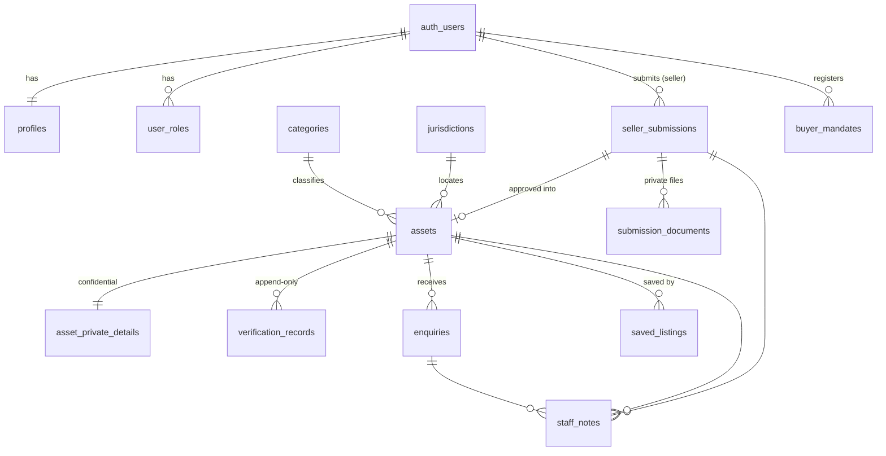
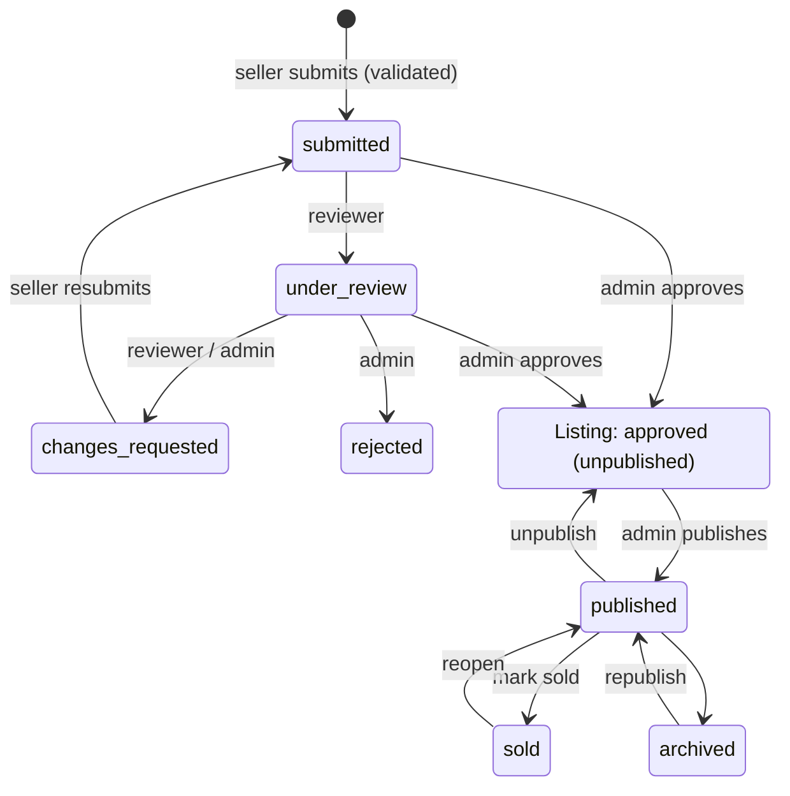

# Global Financial Assets

A confidential, moderated marketplace for the acquisition of regulated financial businesses: banks, EMIs and payment institutions, crypto-asset businesses, financial licences, brokerages, investment firms and funds, iGaming, payment infrastructure, insurance and other financial businesses.

> **Demo data.** The seed data contains clearly labelled, fictitious **DEMO** listings only. They are flagged `is_demo` in the database, titled `[DEMO] …`, badged in the UI, excluded from search indexing and the sitemap, have no seller attached, and cannot receive enquiries (enforced in the database). Any verification state shown on a demo listing is labelled "Demo" and does not represent a real check. Remove them with `supabase/scripts/remove-demo-data.sql`.

---

## Contents

1. [Features](#features)
2. [Tech stack](#tech-stack)
3. [Project structure](#project-structure)
4. [Quick start](#quick-start)
5. [Environment configuration](#environment-configuration)
6. [Database schema](#database-schema)
7. [Access control and security model](#access-control-and-security-model)
8. [Listing lifecycle and verification](#listing-lifecycle-and-verification)
9. [Testing](#testing)
10. [Deployment](#deployment)
11. [Before going live](#before-going-live)
12. [Scripts](#scripts)

---

## Features

**Public site**
- Institutional design system: deep navy `#0B1F35`, white, slate and champagne gold `#D9B36C`, Source Serif 4 and Inter (self-hosted), generated financial-district hero artwork.
- Homepage: hero search, ten asset categories with live counts, featured opportunities, trust and verification explanation, buyer/seller process, seller call to action, insights, important notice and a detailed footer.
- Marketplace: keyword search (Postgres full-text), filters for category, jurisdiction, price range (EUR equivalent), transaction type, operating status, verification status and sold listings; sorting; pagination; removable filter chips; reset; a mobile filter sheet. All filter state lives in the URL, so results can be shared and bookmarked.
- Listing pages: structured deal information, included assets, licence and regulator, verification state and date, asking price or price on request, regulatory caveats, a confidential enquiry form and related opportunities.
- SEO: per-page titles and descriptions, canonical URLs, Open Graph, JSON-LD breadcrumbs, category and jurisdiction landing pages, admin-editable metadata overrides, a sitemap generator and `noindex` on demo listings.
- Disclaimers throughout: listings are not offers or guarantees, licences may not be transferable, acquisitions can require regulatory approval, and verification is not due diligence.

**Accounts and workflows**
- Buyer and seller registration (email and password), sign in, password reset.
- Buyers: saved listings, enquiry history, acquisition mandates with live matching against published listings.
- Sellers: multi-section submissions with drafts, server-validated submission, resubmission after review, withdrawal, and upload of confidential documents to private storage.
- Reviewers: review queue, request changes, record verification checks, open documents through an audited, short-lived link.
- Administrators: everything reviewers can do, plus approve and reject submissions; publish, unpublish, archive and mark listings sold; edit listing content and confidential details; handle enquiries; view mandates; manage users and roles; edit SEO metadata; read the audit log.

## Tech stack

| Layer | Choice |
| --- | --- |
| Frontend | React 18, TypeScript, Vite 6, Tailwind CSS 3, React Router 6, TanStack Query 5, React Hook Form + Zod, Radix primitives, lucide icons |
| Backend | Supabase (Postgres 15+, Auth, Storage, Edge Functions). Compatible with Lovable Cloud, which is Supabase |
| Security | Row-level security on every table, column-level grants, guard triggers, security-definer RPCs, private storage bucket, audited Edge Function |
| Tests | Vitest (unit), Node test runner + supabase-js (API and database security), Playwright (end-to-end, mobile), axe-core (accessibility) |

## Project structure

```
src/
  components/       ui/ (design-system primitives), layout/, home/, marketplace/,
                    dashboard/, admin/, auth/, seo/, status/
  config/site.ts    Site name, navigation, contact details, hero image
  content/          Editorial insights (versioned in code)
  hooks/            Data hooks (auth, listings, dashboard, admin)
  integrations/supabase/  Typed client and database types
  lib/              Constants, filters, formatting, schemas, document helpers
  pages/            Public pages, auth/, dashboard/, admin/, legal/
supabase/
  migrations/       Schema, roles, integrity triggers, RPCs, RLS + grants, storage, reference data
  functions/        document-access Edge Function (+ shared CORS helper)
  seed.sql          DEMO listings only
  scripts/          grant-admin.sql, remove-demo-data.sql
  config.toml       Supabase CLI configuration
scripts/
  local-stack/      Docker-free Supabase-compatible stack for development and CI
  generate-*.mjs    Skyline artwork, Open Graph image, sitemap
tests/security/     API and database security suite (40 tests)
e2e/                Playwright end-to-end, accessibility and mobile suites
```

## Quick start

Requirements: Node.js 20.19+ (22 recommended).

```bash
npm install
```

Then choose a backend.

### Option A: Supabase CLI (Docker)

```bash
npx supabase start          # applies supabase/migrations and supabase/seed.sql
cp .env.example .env.local  # set VITE_SUPABASE_URL=http://127.0.0.1:54321 and the anon key it prints
npx supabase functions serve document-access
npm run dev
```

### Option B: Docker-free local stack

`scripts/local-stack/up.sh` runs the real Supabase services as native processes: PostgreSQL (system binaries), Supabase Auth (GoTrue), PostgREST, Storage API, the Deno Edge Function, an SMTP sink for auth emails, and a small gateway on `:54321` that mirrors Supabase's URL layout. The first run downloads binaries and builds the Storage API into `.local-stack/` (git-ignored).

```bash
npm run stack:up -- --reset   # fresh database: migrations + demo seed
npm run dev:local             # Vite in "localstack" mode (reads the generated .env.localstack)
npm run stack:down
```

Local auth auto-confirms emails, and outgoing auth emails are written to `.local-stack/mail/`. Requires PostgreSQL 15+ server binaries (`initdb`, `pg_ctl`), `curl`, `git` and `python3`.

### Create the first administrator

Register through the UI, then grant the role once with a privileged connection:

```bash
psql "$DATABASE_URL" -v email="'you@example.com'" -f supabase/scripts/grant-admin.sql
```

Further reviewer and admin roles are granted from **Admin → Users & roles**. Those grants go through `set_user_role()` and are audited.

## Environment configuration

Only two values reach the browser, and both are public by design:

| Variable | Where | Purpose |
| --- | --- | --- |
| `VITE_SUPABASE_URL` | `.env.local` / hosting env | Supabase project URL |
| `VITE_SUPABASE_ANON_KEY` | `.env.local` / hosting env | Anon (publishable) key. Safe to expose because every table is protected by RLS |
| `VITE_SITE_URL` | `.env.local` / hosting env | Canonical URLs, Open Graph and the sitemap |

**Server-side secrets never use the `VITE_` prefix.** `vite.config.ts` refuses to build if a `VITE_` variable looks like a secret (`SERVICE_ROLE`, `SECRET`, `PRIVATE`, `PASSWORD`, …). The service-role key is used only inside the Edge Function, where Supabase injects it automatically.

Edge Function secrets (set with `supabase secrets set …`):

| Secret | Purpose |
| --- | --- |
| `ALLOWED_ORIGINS` | Comma-separated origins allowed to call `document-access` (for example `https://www.example.com`). Defaults to none |
| `SUPABASE_URL`, `SUPABASE_ANON_KEY`, `SUPABASE_SERVICE_ROLE_KEY` | Provided by Supabase automatically |

Site copy that must be replaced before launch is in `src/config/site.ts`: contact email, legal entity name, and an optional licensed hero photograph (`hero.imageUrl`).

## Database schema

All application tables live in `public`. Internal helper functions live in a `private` schema that PostgREST does not expose.



| Table | Purpose | Who can read / write |
| --- | --- | --- |
| `profiles` | Name, company, contact and buyer preferences (created by the sign-up trigger) | Owner and admins read; owner updates whitelisted columns |
| `user_roles` | `buyer`, `seller`, `reviewer`, `admin` (kept separate from profiles to prevent self-escalation) | Owner and admins read; written only by functions |
| `categories`, `jurisdictions` | Taxonomy with descriptions and SEO fields | Public read; admin write |
| `currency_rates` | Indicative FX used to normalise prices for filtering (`asking_price_eur`) | Public read; admin update |
| `assets` | Marketplace listings and their lifecycle (`status`, approval, publication, verification) | Staff read all; sellers read their own; admins edit content columns only |
| `marketplace_listings` (view) | The **only** public listing surface: published or sold rows, whitelisted non-confidential columns | Public read |
| `asset_private_details` | Company legal name, registration and licence numbers, contacts, internal notes | Staff and the listing's seller read; admins write |
| `seller_submissions` | The seller's working copy, including confidential fields and review feedback | Seller (own) and staff read; seller edits while `draft` or `changes_requested` |
| `submission_documents` | Metadata for files in the private bucket | Owner and staff read; owner adds or removes while editable |
| `verification_records` | Append-only reviewer checks (level, method, source, notes, reviewer, date) | Staff and the listing's seller read; staff insert |
| `enquiries` | Confidential buyer enquiries (personal data) | The buyer and admins read; created only via `submit_enquiry()`; admins update `status` |
| `saved_listings` | Buyer shortlists | Owner only; only published or sold listings can be saved |
| `buyer_mandates` | Acquisition criteria | Owner and admins |
| `staff_notes` | Internal notes on submissions, listings and enquiries | Staff (enquiry notes admin-only); append-only |
| `audit_logs` | Append-only audit trail | Admins read; written by triggers and functions only; updates and deletes are blocked for everyone |
| `page_metadata` | SEO overrides per path (title, description, image, noindex) | Public read; admin write |

Enums: `app_role`, `asset_status`, `verification_level`, `transaction_type`, `operating_status`, `submission_status`, `enquiry_status`, `mandate_status`.

Database functions (RPC), each re-checking the caller's role:

| Function | Caller | Purpose |
| --- | --- | --- |
| `submit_enquiry` | anyone | Validates input, refuses demo, unpublished and sold listings, throttles abuse, records the enquiry |
| `listing_counts` | anyone | Published counts per category and jurisdiction |
| `add_self_service_role` | signed-in | Adds `buyer` or `seller` only |
| `withdraw_submission` | seller | Withdraws own submission |
| `start_submission_review`, `request_submission_changes` | reviewer/admin | Review workflow |
| `approve_submission`, `reject_submission` | admin | Approval creates an **unpublished** listing and separate private details |
| `set_asset_status` | admin | Listing state machine (see below) |
| `set_user_role`, `admin_list_users`, `admin_dashboard_stats` | admin (stats: staff) | Administration |

## Access control and security model

Permissions are enforced in Postgres. The UI only reflects them.

| Capability | Visitor | Buyer | Seller | Reviewer | Admin |
| --- | :-: | :-: | :-: | :-: | :-: |
| Browse published listings | ✓ | ✓ | ✓ | ✓ | ✓ |
| Send enquiries | ✓ | ✓ | ✓ | ✓ | ✓ |
| Save listings, track own enquiries | | ✓ | ✓ | ✓ | ✓ |
| Acquisition mandates | | ✓ | | | read all |
| Create and edit own submissions, upload documents | | | ✓ | | |
| Read all submissions and listings (incl. unpublished) | | | own | ✓ | ✓ |
| Open confidential documents | | | own | via audited link | via audited link |
| Request changes, record verification | | | | ✓ | ✓ |
| Approve, reject, publish, archive, mark sold | | | | | ✓ |
| Read enquiries and buyer data | | own | | | ✓ |
| Manage roles, metadata; read audit log | | | | | ✓ |

How it is enforced:

1. **RLS on every table**, with policies built on `private.has_role / is_admin / is_staff` (security definer, not callable through the API).
2. **Least-privilege grants.** Supabase's default `GRANT ALL` is revoked. API roles receive explicit table and column privileges. For example, an admin can update listing *content* columns but has no privilege on `status`, `verification_status`, `approved_at` or `is_demo`, so those can only change through the moderation functions.
3. **Guard triggers** (security invoker, so `current_user` is the API role) force API-created listings to `draft`/`unverified`, block protected-field edits, validate submission completeness server-side, force verification records to be attributed to the calling reviewer, and make verification records and the audit log append-only.
4. **A public view as the only public surface.** `marketplace_listings` is a `security_barrier` view that exposes published or sold rows and whitelisted columns. Anonymous users have no privileges on `assets`. Supabase's advisor flags security-definer views; this one is intentional and documented in the migration.
5. **Private storage.** The `confidential-documents` bucket is private (25 MB, document MIME types only). Sellers can upload only to `<their uid>/<their editable submission>/…` and read or delete only their own objects. **Reviewers and admins have no direct storage access.** They call the `document-access` Edge Function, which authorises through RLS as the caller, issues a 60-second signed URL with the service role, and fails closed if it cannot write the audit entry.
6. **Sign-up cannot escalate privileges.** The sign-up trigger grants only `buyer` or `seller`, whatever metadata is sent.
7. **Secrets never reach the browser.** Only the anon key is bundled, and the build fails if a secret-looking `VITE_` variable exists.
8. **Audit trail.** Changes to listings, submissions, documents, verification, roles, enquiries, mandates, metadata and taxonomy are logged with actor and changed fields. Values are recorded only for non-sensitive workflow fields, never confidential data. Document access and every moderation action are logged explicitly.

## Listing lifecycle and verification



- **Nothing is public until an administrator approves and then publishes it.** A database constraint requires `approved_at` for any published or sold listing, and `set_asset_status` refuses to publish an unapproved listing.
- **Verification states:** Unverified, Company Checked, Regulator Record Checked, Documents Reviewed. A listing's state is derived by trigger from the latest `verification_records` row, which only reviewers or admins can create and which is attributed to them. It cannot be set by sellers, buyers or direct updates.

## Testing

| Suite | Command | Covers |
| --- | --- | --- |
| Unit | `npm test` | Filter parsing and URL round-trips, input sanitising, price and date formatting, redirect safety, form schemas, pagination, verification dates (20 tests) |
| Security (API + DB) | `npm run test:security` | 40 tests calling the real API as each role: anonymous access to private tables, privilege escalation at sign-up and via RPC, buyer/seller/reviewer/admin separation, column-level protections, submission validation and locking, private storage isolation, the audited document function, approval → unpublished → publish, the state machine, reviewer-only append-only verification, enquiry rules and throttling, buyer data confidentiality, the append-only audit log and absence of confidential values in it |
| End-to-end | `npm run test:e2e` | Homepage, hero search, every marketplace filter, sort, pagination, reset, keyword search and empty state, detail page safeguards, SEO pages and metadata, 404s, auth guards, sign-in validation; the full cross-role journey (seller registers → validation → draft → document upload → submit → reviewer requests changes and opens the document → seller resubmits → admin approves (still private) → verification recorded → publish → anonymous enquiry → buyer registers, saves, creates a matching mandate → buyer blocked from admin → admin handles the enquiry, marks sold → audit log) |
| Accessibility | included in `test:e2e` | axe-core WCAG 2.1 A/AA scan of 10 pages: no serious or critical violations |
| Mobile | included in `test:e2e` | Pixel 7: navigation sheet, filter sheet, no horizontal overflow |

The security and end-to-end suites need the local stack (`npm run stack:up -- --reset`). Playwright builds the app in `localstack` mode and serves it with `vite preview`. `.github/workflows/ci.yml` runs all suites on every push.

## Deployment

### 1. Supabase project (or Lovable Cloud)

```bash
npx supabase login
npx supabase link --project-ref <ref>
npx supabase db push                                   # applies supabase/migrations
psql "$DATABASE_URL" -f supabase/seed.sql              # optional: DEMO listings
npx supabase functions deploy document-access
npx supabase secrets set ALLOWED_ORIGINS=https://www.example.com
```

In the Supabase dashboard:
- **Auth → URL configuration:** set the Site URL to your domain and add `https://<domain>/reset-password` and `https://<domain>/dashboard*` to the redirect URLs.
- **Auth → Providers → Email:** keep email confirmations on, set the minimum password length to 10, and enable leaked-password protection.
- **Auth → SMTP:** configure a production SMTP provider. The default sender is heavily rate-limited.
- **Auth → Rate limits / Attack protection:** consider enabling CAPTCHA (hCaptcha or Turnstile) for sign-ups.
- The private bucket and its policies are created by migration `…06_storage.sql`. Do not make the bucket public.
- Bootstrap the first admin with `supabase/scripts/grant-admin.sql`.

**Lovable:** import this GitHub repository into Lovable and connect Lovable Cloud or an existing Supabase project. The layout follows Lovable's conventions (`src/integrations/supabase/client.ts`, `types.ts`). Apply the migrations to the connected database before use.

### 2. Frontend

Any static host that supports SPA rewrites works. `vercel.json` is included, with rewrites, long-lived asset caching and security headers (HSTS, CSP, X-Frame-Options, Referrer-Policy, Permissions-Policy). If your API uses a custom domain, add it to the CSP `connect-src`.

```bash
# environment: VITE_SUPABASE_URL, VITE_SUPABASE_ANON_KEY, VITE_SITE_URL
npm run generate:sitemap   # optional: writes public/sitemap.xml and adds it to robots.txt
npm run build              # outputs dist/
```

Netlify or Cloudflare Pages: add a `/* /index.html 200` rewrite and the same headers.

### 3. Regenerating database types

After schema changes: `npx supabase gen types typescript --project-id <ref> > src/integrations/supabase/types.ts`. The handwritten file follows the generated format, and the convenience aliases at its end should be kept.

## Before going live

These are deliberate gaps or placeholders that need a decision from the operator:

- **Legal:** the terms, privacy notice and important notice are templates and are marked as such on the pages. Have counsel complete them for the operating entity and jurisdiction. Replace the placeholder contact email and legal entity in `src/config/site.ts`.
- **Notifications:** new enquiries and submissions appear in the admin console. No email or Slack notification is sent yet. Add a Database Webhook or Edge Function if you need alerts.
- **Abuse protection:** `submit_enquiry` validates and throttles per email and globally for anonymous traffic. For a public launch, add CAPTCHA verification for anonymous enquiries and enable Supabase Auth CAPTCHA.
- **SEO for crawlers:** the app is a client-rendered SPA with Helmet-managed metadata. For maximum search visibility, add prerendering or SSR for public routes.
- **FX rates** in `currency_rates` are indicative and only used for price filtering. Update them periodically (Admin can update via SQL; a UI is not included).
- **Imagery:** the hero is generated SVG artwork (`npm run generate:skyline`). Swap in licensed photography via `site.hero.imageUrl` if preferred.
- **Audit retention:** the audit log is append-only even for the database owner. If a retention policy is required, implement it as a reviewed migration that temporarily disables the trigger.
- **Demo data:** remove it with `supabase/scripts/remove-demo-data.sql` before onboarding real listings.

## Scripts

| Script | Description |
| --- | --- |
| `npm run dev` / `dev:local` | Vite dev server (local stack mode for `dev:local`) |
| `npm run build` / `build:local` | Typecheck and production build |
| `npm run lint` / `typecheck` | ESLint / TypeScript |
| `npm test` | Unit tests (Vitest) |
| `npm run test:security` | API and database security suite |
| `npm run test:e2e` | Playwright end-to-end, accessibility and mobile suites |
| `npm run stack:up [-- --reset]` / `stack:down` | Docker-free local Supabase stack |
| `npm run generate:skyline` | Regenerate the hero SVG |
| `node scripts/generate-og-image.mjs` | Regenerate `public/og-image.png` |
| `npm run generate:sitemap [-- <mode>]` | Write `public/sitemap.xml` from live data |
